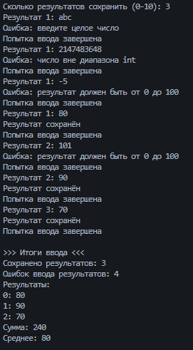

# Практическая работа №25

Автор: Белоярова Александра
Группа: ИСП-251

## Тема

Исключения в C#.

## Что реализовано

- ввод количества через TryParse;
- повторный ввод результатов после ошибок;
- обработка FormatException и OverflowException;
- проверка диапазона через throw и ArgumentOutOfRangeException;
- завершение каждой попытки через finally;
- сохранение корректных результатов и вывод статистики.
## Короткие ответы

1. С какой строки продолжается выполнение после обработанного исключения?

Ответ: выполнение продолжается со строки следующей за всей конструкцией try catch, а не с той строки внутри try где возникла ошибка. Пропущенный остаток блока try не выполняется

2. Для чего нужен finally и почему он не заменяет catch?

Ответ: finally выполняется при завершении конструкции в любом случае и нужен для действий которые должны произойти всегда. Он не обрабатывает исключение без подходящего catch ошибка всё равно пойдёт дальше вызывающему коду

3. Когда удобнее использовать TryParse вместо Parse с обработкой исключения?

Ответ: Когда неверный ввод пользователя обычная, ожидаемая ситуация. TryParse возвращает false без исключения код получается проще и работает быстрее

## Результат

